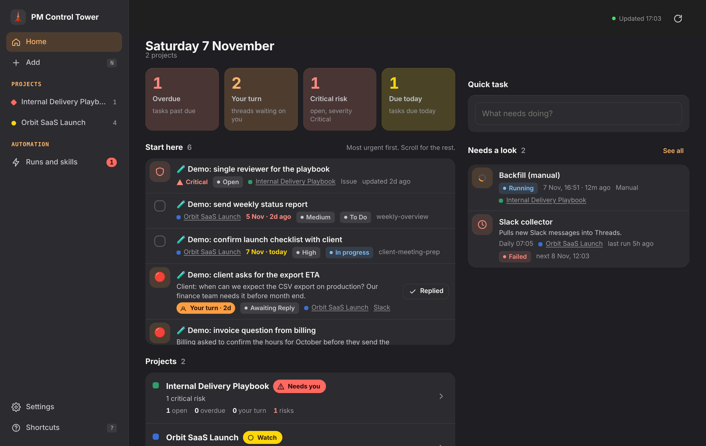

# PM Control Tower dashboard

**English** | [Українська](README.uk.md)

An installable web app (PWA) over your PM Control Tower Notion databases. It opens on any device (Mac, Windows, iPhone, Android) and shows everything a PM checks during the day in one place: tasks, threads (email, Slack), meetings, decisions, risks, reports, the Current State page and key numbers per project. You can act from the dashboard too: add or close a task, change a risk or a thread status, log a decision. An optional read-only Automation page shows what your scheduled tasks ran, what is running and what is next.



## What you see

The 2.1 layout is a "calm dashboard": one sentence per page, quiet numbers, at most one colored fact per row, actions hidden until you need them.

| View | Content |
|---|---|
| **Today** | A sentence ("2 replies and 3 tasks need you"), a strip of numbers that doubles as a filter (Needs you, Overdue, Your turn, Critical risk, Due today), a line when a scheduled task failed, the **Needs you** queue (5 rows on a phone, 7 on a laptop, then "N more"), quiet lines "N to nudge" and "N stale threads, Review", the **Next call** (the next meeting today or tomorrow with 2 or 3 things to raise) and **Projects** (one sentence and a health word each; quiet projects folded) |
| **Inbox** | Notes captured with "+"; route each to a project as a task (project required, due date, priority) |
| **Project** | Four tabs: Overview (Your move, to nudge, Risks to watch, Next call, Latest decision and report, Current state, the project's automation), Work (Tasks or Threads grouped by their Notion status, filters, a stale block), Log (meetings, decisions and reports in one stream), Risks (by trigger date, then severity). The "..." menu opens Current state, the project's Automation and the project in Notion. On a phone the project is one page plus "Everything in this project" |
| **Automation** | Read-only: what needs a look, the schedule as a table (General first, then per project), skills with search. Everything runs from Cowork; nothing is started from the dashboard |
| **Settings** | Language, theme, projects on the board, whose-turn swap, keyboard shortcuts |

**One definition per number.** Every metric, the queue, health and freshness live in one module (`public/js/logic.js`). A click on a number opens exactly the rows it counted; the tooltip gives the formula. The Worker returns lists, not numbers.

**Freshness.** Age counts from the last message on either side, or from your last manual change, whichever is later. 14 to 30 days: a gray "quiet" in the row. 30 days and more: stale, out of every number, badge and queue, collected in one line with a review (Close, Keep for context = Spectator Mode, Still relevant, Skip) and "Close all older than 90d" with one undo. Their turn shows as "to nudge" only after 5 days. The thresholds are in `app.freshness` (a project can override them).

**Health** is a rule, not a score. Red "Needs you": a critical risk, an overdue High task, or a thread on your turn for more than 2 working days. Amber "Watch": anything overdue or due today, a high risk, or any thread on your turn. Green "On track" otherwise. Each state has its own shape and word, not only a color.

**Whose turn** comes from `app.turn` in the config (a project can override it). The default follows `projects/_standards.md` section 11: `Awaiting Reply` is your turn, `Need Follow-up` is theirs. Settings has a switch to swap them on one device.

**Dates follow one rule:** under 7 days relative ("today 15:00", "tomorrow", "Mon", "3d"), older "4 Nov", the year only when it differs, overdue "2d late". ISO timestamps are never shown, also not inside meeting titles.

**Risks** use two optional date properties, `Trigger Date` and `Last Reviewed`. With them a risk shows "in 2d", "not reviewed 15d" after 14 days, and has a Reviewed action. Without them these parts are hidden and risks sort by severity.

**Gestures and keys.** Phone: swipe right is the main action (task Done, your-turn thread Replied, risk Reviewed); swipe left snoozes a task to tomorrow (a long swipe opens the date choice); tap opens the details sheet with every action as a button; long press opens the status menu; pull down to refresh. Laptop: actions appear on hover or focus; J and K move, Enter opens, E done, R replied, S snooze, N add, / filter, ⌘K search and jump, ? all keys. Every change shows Undo for 6 seconds and is written to Notion when the toast ends. Offline, changes wait in a queue (a clock mark on the row) and sync when the connection returns; if the record changed in Notion meanwhile, the change is dropped with "Changed in Notion, action not applied".

Every record carries its project. The dashboard reads and writes only the projects listed in its config and refuses records of any other project. When you create a task or a decision you pick the project explicitly: the dashboard never guesses it (Default Project Rule). An Inbox note can have no project.

## What it can change

| Database | Actions |
|---|---|
| Tasks Tracker | done or reopen, snooze (moves the due date), status, priority, new task (`Source = manual`), a task made from a thread, a task routed from the Inbox (`Source = inbox`) |
| Threads | status, with the matching page icon. A status set here is a human decision: it writes `Manual Status At`, and the collectors keep it until the thread gets a new message (`projects/_standards.md` section 11). "Still relevant" in the stale review writes only `Manual Status At` |
| Risks | status, severity, Reviewed (`Last Reviewed` = today, only when the property exists); every change sets `Last Updated` = today |
| Decisions | new decision (`Status = Active`), Superseded or Cancelled |
| Inbox | new note (project optional), route to Tasks (`Status = Routed`) |

A change that arrives while the record was edited in Notion after the dashboard loaded it is refused (HTTP 409) instead of overwriting the newer edit. Automation is read-only. Nothing is sent to anyone. The dashboard writes only to your Notion.

## Ask Claude

A card (a thread, a task or a risk) has an **Ask Claude** button, and the key `A` does the same in a list. It copies a short context pack to the clipboard: the project and its slug, the Notion page id and links, the status, the Jira key, and related candidates from what the dashboard already loaded (meetings of the same project within 21 days, tasks, threads and decisions that share a Jira key or words). Paste it into Claude (Cowork or the phone app) and add one sentence after `My decision:`. The `resolve-item` skill then verifies the candidates in Notion, shows a plan (Decision, task with the agreed date, thread status, one Topic linking the story) and writes after your OK. The dashboard itself runs nothing and writes nothing for this.

## How it works

```
phone / laptop  ──►  Cloudflare Access (login with your email)
                         │
                         ▼
                Cloudflare Worker ── serves the PWA (public/)
                         │           and the /api routes (src/)
                         ▼
                     Notion API  (your integration token, a Worker secret)
```

- The Notion API cannot be called from a browser, and the token must not reach one, so a small Worker sits in between. It runs on the Cloudflare free plan.
- **Your data stays yours.** The repository holds only code. Your database IDs and project list live in `config/dashboard.config.json`, your Access settings in `wrangler.toml`, and your Notion token in a Worker secret. All three are git-ignored, so a clone of this repository connects to nothing until its owner fills them in with their own resources.
- Access protects the whole app, static files included. The Worker checks the Access token again (signature, audience, expiry, optional email allow-list) and refuses everything when Access is not configured.
- Reads are cached for 30 seconds inside the Worker; any write clears the cache. The app keeps the last good data for offline use and says when it shows cached data.

## Set up (about 20 minutes)

You need: Node 18+, a free Cloudflare account, and your Control Tower in Notion.

1. **Notion integration.** In Notion, Settings > Connections > Develop or manage integrations, create an internal integration with read and update content. Copy its token. Share the Control Tower page (with its databases) and every Current State page with this integration.
2. **Install and create local files.**
   ```bash
   cd tools/dashboard
   npm install
   npm run setup        # creates config/dashboard.config.json and wrangler.toml
   ```
3. **Fill in `config/dashboard.config.json`.** The `notion.*` values are the same data source IDs as in `projects/<slug>.md` (`collection://...`). Add one entry per project: `slug`, `name`, `color`, `project_page_id`, `workspace_page_id`, `current_state_page_id`. Property names follow `docs/en/02-notion-control-tower.md`; if yours differ, override them under `schema` (see `src/schema.js`).
4. **Token.**
   ```bash
   npx wrangler login
   npx wrangler secret put NOTION_TOKEN
   ```
5. **Deploy.** `npm run deploy` prints the `*.workers.dev` URL. If Wrangler cannot reach Cloudflare from your machine, run `npm run build:single` and upload `dist/worker.single.mjs` as described in `DEVELOPMENT.md`.
6. **Access.** In the Cloudflare dashboard: Workers > your Worker > Settings > Domains & Routes, enable Cloudflare Access on the workers.dev route (or create a self-hosted Access application for a custom domain). Allow only your email. Copy the application **Audience (AUD) tag** and your team domain (`<team>.cloudflareaccess.com`) into `wrangler.toml`, set `ALLOWED_EMAILS`, and run `npm run deploy` again.
7. **Install the app.** Open the URL and log in. On iPhone: Share > Add to Home Screen. On Android or desktop Chrome/Edge: Install app.

A custom domain such as `dashboard.example.com` works only for a domain whose DNS is hosted in Cloudflare. The workers.dev URL needs no DNS changes.

## Threads: manual status

The Threads database needs two properties (in the public template since 1.10.0): **`Manual Status At`** (date) and **`Collector Status`** (text). The dashboard writes `Manual Status At` when you change a status; the collectors write every status they set into `Collector Status` too, so a status you change directly in Notion is recognised as well. A manual status is kept until a message newer than `Manual Status At` arrives; then the collectors recompute it and clear the date. Without these properties the dashboard still changes the status but warns that the next collector run may overwrite it.

## Try it without Notion

```bash
npm install
npm run demo     # mock Notion with demo data on http://localhost:8787
npm test         # API and Access checks, client rules, WCAG AA contrast of the tokens
```

## Continue development

`DEVELOPMENT.md` is the handoff: code map, demo and tests, recipes for a new view or action, deploy paths, roadmap. `DESIGN-BRIEF.md` is the brief for a UI/UX redesign.

## Files

| Path | What |
|---|---|
| `public/` | the PWA: `index.html`, `styles.css`, `sw.js`, manifest, icons, and `js/` (ES modules, no build step) |
| `src/worker.js` | Worker entry: Access check, static files, `/api` |
| `src/worker-inline.js`, `scripts/build-single.mjs` | the same Worker as one module with the PWA embedded |
| `src/api.js` | queries and the allowed writes (the numbers are counted in `public/js/logic.js`) |
| `src/notion.js` | Notion REST client (API version 2025-09-03) |
| `src/auth.js` | Cloudflare Access token verification |
| `src/schema.js` | property names of the Control Tower databases |
| `config/dashboard.config.example.json` | config template (your copy is git-ignored) |
| `wrangler.example.toml` | Worker settings template (your copy is git-ignored) |
| `test/` | mock Notion, demo server, API smoke tests, client rule tests (`logic.mjs`), contrast check (`contrast.mjs`) |
