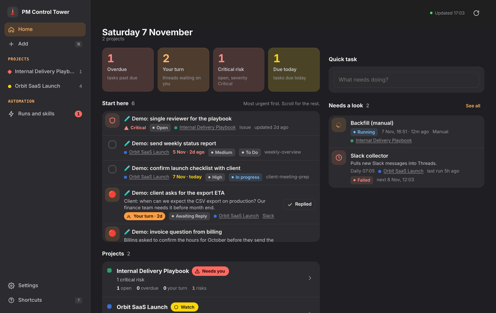

# Дашборд PM Control Tower

[English](README.md) | **Українська**

Веб-застосунок (PWA), який можна встановити як апку і який працює поверх баз PM Control Tower у Notion. Відкривається на будь-якому пристрої (Mac, Windows, iPhone, Android) і показує в одному місці все, що PM перевіряє протягом дня: задачі, треди (пошта, Slack), мітинги, рішення, ризики, звіти, сторінку Current State і ключові цифри по кожному проєкту. Діяти можна прямо з дашборда: додати чи закрити задачу, змінити статус ризику чи треду, записати рішення. Необовʼязкова сторінка Automation (лише перегляд) показує, що відпрацювали scheduled tasks, що працює зараз і що далі.



## Що видно

Макет 2.1 це "спокійний дашборд": одне речення на сторінку, тихі числа, щонайбільше один кольоровий факт у рядку, дії сховані, доки не потрібні.

| Екран | Зміст |
|---|---|
| **Сьогодні** | Речення ("2 відповіді і 3 задачі чекають на тебе"), смуга чисел, яка водночас фільтр (Потрібен ти, Прострочено, Твоя черга, Критичні ризики, На сьогодні), рядок, коли таска за розкладом впала, черга **Потрібен ти** (5 рядків на телефоні, 7 на ноутбуці, далі "ще N"), тихі рядки "N нагадати" і "N застарілих тредів, Розібрати", **Наступний дзвінок** (найближчий мітинг сьогодні чи завтра з 2-3 пунктами, що підняти) і **Проєкти** (одне речення і слово стану на кожен; тихі проєкти згорнуті) |
| **Inbox** | Нотатки, додані через "+"; кожну можна перенести в проєкт як задачу (проєкт обовʼязковий, дедлайн, пріоритет) |
| **Проєкт** | Чотири вкладки: Огляд (Твій хід, нагадати, Ризики під наглядом, Наступний дзвінок, Свіже: останнє рішення і звіт, Current state, автоматизація проєкту), Робота (Задачі або Треди, згруповані за статусом Notion, фільтри, блок застарілих), Журнал (мітинги, рішення і звіти однією стрічкою), Ризики (за датою спрацювання, потім severity). Меню "..." відкриває Current state, автоматизацію проєкту і сам проєкт у Notion. На телефоні проєкт це одна сторінка плюс "Усе в цьому проєкті" |
| **Автоматизація** | Лише перегляд: що варто глянути, розклад таблицею (спершу загальні, потім за проєктами), скіли з пошуком. Усе запускається з Cowork; з дашборда нічого не запускається |
| **Налаштування** | Мова, тема, проєкти на дошці, обмін "чия черга", клавіші |

**Одне визначення на кожне число.** Усі метрики, черга, стан проєкту і свіжість живуть в одному модулі (`public/js/logic.js`). Клік по числу відкриває рівно ті рядки, з яких воно пораховане; підказка показує формулу. Worker повертає списки, а не числа.

**Свіжість.** Вік рахується від останнього повідомлення з будь-якого боку або від твоєї останньої ручної зміни, що пізніше. 14-30 днів: сіре "тихо" в рядку. 30 днів і більше: тред застарілий, його немає в жодному числі, бейджі й черзі; такі треди зібрані в один рядок з розбором (Закрити, Лишити для контексту = Spectator Mode, Ще актуальний, Пропустити) і "Закрити всі старші 90 д" з одним "Відмінити". Їхня черга показується як "нагадати" лише після 5 днів. Пороги в `app.freshness` (проєкт може їх перевизначити).

**Стан проєкту** це правило, а не бал. Червоний "Потрібен ти": критичний ризик, прострочена High-задача або тред на твоїй черзі довше 2 робочих днів. Бурштиновий "Під наглядом": будь-що прострочене чи на сьогодні, високий ризик або будь-який тред на твоїй черзі. Інакше зелений "Все гаразд". Кожен стан має свою форму і слово, а не лише колір.

**Чия черга** береться з `app.turn` у конфігу (проєкт може перевизначити). Типово як у `projects/_standards.md`, розділ 11: `Awaiting Reply` це твоя черга, `Need Follow-up` їхня. У Налаштуваннях є перемикач, який міняє їх місцями на одному пристрої.

**Дати за одним правилом:** до 7 днів відносно ("сьогодні 15:00", "завтра", "пн", "3 д"), далі "4 лист", рік лише якщо інший, прострочка "прострочено 2 д". ISO-міток ніде немає, зокрема в назвах мітингів.

**Ризики** використовують дві необовʼязкові дати, `Trigger Date` і `Last Reviewed`. З ними ризик показує "за 2 д", "без перегляду 15 д" після 14 днів і має дію "Переглянуто". Без них ці частини сховані, а ризики сортуються за severity.

**Жести і клавіші.** Телефон: свайп вправо це основна дія (задача Done, тред твоєї черги Replied, ризик Переглянуто); свайп вліво відкладає задачу на завтра (довгий свайп відкриває вибір дати); тап відкриває шторку деталей: повний текст запису і вміст сторінки (у блоці, що прокручується, коли текст довгий) і всі дії кнопками; довге натискання відкриває меню статусу; потягни вниз, щоб оновити. Ноутбук: дії зʼявляються при наведенні чи фокусі; J і K рух, Enter відкрити, E done, R replied, S відкласти, N додати, / фільтр, ⌘K пошук і перехід, ? усі клавіші. Кожна зміна показує "Відмінити" 6 секунд і пишеться в Notion, коли toast зникає. Офлайн зміни чекають у черзі (позначка годинника в рядку) і синхронізуються, коли звʼязок повертається; якщо запис тим часом змінили в Notion, зміна скасовується з повідомленням "Змінено в Notion, дію не застосовано".

Кожен запис має свій проєкт. Дашборд читає і пише тільки проєкти зі свого конфігу і відмовляє для записів будь-якого іншого проєкту. Коли створюєш задачу чи рішення, проєкт обираєш явно: дашборд ніколи його не вгадує (Default Project Rule). Нотатка в Inbox може бути без проєкту.

## Що він може змінювати

| База | Дії |
|---|---|
| Tasks Tracker | виконано або знову відкрити, відкласти (переносить дедлайн), статус, пріоритет, нова задача (`Source = manual`), задача з треду, задача з Inbox (`Source = inbox`) |
| Threads | статус і відповідна іконка сторінки. Статус, поставлений тут, це рішення людини: він записує `Manual Status At`, і колектори тримають його, доки в треді не зʼявиться нове повідомлення (`projects/_standards.md`, розділ 11). "Ще актуальний" у розборі застарілих пише лише `Manual Status At` |
| Risks | статус, severity, Переглянуто (`Last Reviewed` = сьогодні, лише якщо властивість є); кожна зміна ставить `Last Updated` = сьогодні |
| Decisions | нове рішення (`Status = Active`), Superseded або Cancelled |
| Inbox | нова нотатка (проєкт необовʼязковий), перенесення в задачі (`Status = Routed`) |

Зміна, яка приходить, коли запис уже відредагували в Notion після того, як дашборд його завантажив, відхиляється (HTTP 409), а не перезаписує новішу правку. Automation лише для перегляду. Нікому нічого не відправляється. Дашборд пише тільки у твій Notion.

## Ask Claude

На картці (тред, задача або ризик) є кнопка **Ask Claude**, а в списку те саме робить клавіша `A`. Вона копіює в буфер короткий пакет контексту: проєкт і його slug, id сторінки та посилання Notion, статус, Jira-ключ і кандидатів на звʼязок із вже завантажених даних (зустрічі того ж проєкту в межах 21 дня, задачі, треди й рішення зі спільним Jira-ключем чи словами). Встав його в Claude (Cowork або застосунок на телефоні) і допиши одне речення після `My decision:`. Скіл `resolve-item` перевіряє кандидатів у Notion, показує план (Decision, задача з узгодженою датою, статус треду, один Topic, що обʼєднує історію) і пише після твого ОК. Сам дашборд для цього нічого не запускає і не пише.

## Як це працює

```
телефон / ноутбук  ──►  Cloudflare Access (вхід за твоїм email)
                            │
                            ▼
                   Cloudflare Worker ── віддає PWA (public/)
                            │           і маршрути /api (src/)
                            ▼
                        Notion API  (токен твоєї інтеграції, секрет Worker)
```

- Notion API не можна викликати з браузера, і токен не повинен туди потрапити, тому між ними стоїть маленький Worker. Він працює на безкоштовному плані Cloudflare.
- **Твої дані лишаються твоїми.** У репозиторії тільки код. ID баз і список проєктів живуть у `config/dashboard.config.json`, налаштування Access у `wrangler.toml`, токен Notion у секреті Worker. Усі три в .gitignore, тож клон цього репозиторію ні до чого не підключається, доки власник не впише свої ресурси.
- Access захищає весь застосунок, зокрема статичні файли. Worker ще раз перевіряє токен Access (підпис, audience, термін дії, необовʼязковий список email) і відмовляє в усьому, якщо Access не налаштований.
- Читання кешується на 30 секунд усередині Worker; будь-який запис скидає кеш. Застосунок тримає останні успішні дані для офлайну і показує, коли дані з кешу.

## Налаштування (20-30 хвилин)

Повний покроковий шлях для нової людини, з перевіркою після кожного кроку, таблицею властивостей, Access, пристроями, оновленням, відкатом і типовими помилками: **[docs/uk/20-dashboard-install.md](../../docs/uk/20-dashboard-install.md)**. Коротко:

Потрібно: Node 18+, безкоштовний акаунт Cloudflare із Zero Trust (план Free) і твій Control Tower у Notion.

1. **Інтеграція Notion.** [notion.so/profile/integrations](https://www.notion.so/profile/integrations) > New integration (Internal) з правами Read, Update і Insert content. Скопіюй secret. Підключи інтеграцію до сторінки Control Tower (... > Connections) і до кожної сторінки Current State.
2. **Встанови і створи локальні файли.**
   ```bash
   cd tools/dashboard
   npm install
   npm run setup        # створює config/dashboard.config.json і wrangler.toml (обидва в git-ignore)
   ```
3. **Заповни `config/dashboard.config.json`:** data source ID (`notion.*`, ті самі, що в `projects/<slug>.md`) і по запису на проєкт (`slug`, `name`, `color`, `project_page_id`, `workspace_page_id`, `current_state_page_id`). Назви властивостей за `docs/uk/02-notion-control-tower.md`; інші назви задаються в `schema` (див. `src/schema.js`).
4. **Перевір.** `NOTION_TOKEN='<secret>' npm run doctor` перевіряє файли, кожен плейсхолдер, що токен бачить кожну базу й сторінку, і очікувані властивості. Токен не друкує.
5. **Деплой.** `npx wrangler login`, `npx wrangler secret put NOTION_TOKEN`, `npm run deploy`. Якщо Wrangler не дістає до Cloudflare, `npm run build:single` і завантаж `dist/worker.single.mjs` (`DEVELOPMENT.md`).
6. **Access.** Увімкни Cloudflare Access на маршруті workers.dev (Worker > Settings > Domains & Routes) або self-hosted застосунок Access для власного домену; дозволь лише свою пошту. Впиши team domain і **Audience (AUD) tag** у `wrangler.toml` (`ACCESS_TEAM_DOMAIN`, `ACCESS_AUD`, необовʼязково `ALLOWED_EMAILS`), знову `npm run deploy`, потім `npm run doctor -- --url https://<твоя адреса>`.
7. **Встанови апку.** iPhone: Safari > Поділитися > На екран «Додому». Android або Chrome/Edge на компʼютері: Install app.

Власний домен на кшталт `dashboard.example.com` працює лише для домену, DNS якого в Cloudflare. URL workers.dev не потребує змін DNS. Автодеплой із GitHub: шаблон `.github/workflows/dashboard-deploy.yml.example` (документ 20, розділ 10).

## Треди: ручний статус

Базі Threads потрібні дві властивості (у публічному шаблоні з 1.10.0): **`Manual Status At`** (date) і **`Collector Status`** (text). Дашборд пише `Manual Status At`, коли ти змінюєш статус; колектори кожен статус, який ставлять, пишуть ще й у `Collector Status`, тож статус, змінений прямо в Notion, теж розпізнається. Ручний статус тримається, доки не прийде повідомлення, новіше за `Manual Status At`; тоді колектори його перераховують і очищають дату. Без цих властивостей дашборд усе одно змінить статус, але попередить, що наступний прохід колектора може його перезаписати.

## Спробувати без Notion

```bash
npm install
npm run demo     # mock Notion з демо-даними на http://localhost:8787
npm test         # перевірки API і Access, правила клієнта, doctor, контраст токенів за WCAG AA
```

## Продовжити розробку

`DEVELOPMENT.md` це передача: карта коду, демо і тести, рецепти для нового екрана чи дії, шляхи деплою, роадмап. `DESIGN-BRIEF.md` це бриф для редизайну UI/UX.

## Файли

| Шлях | Що |
|---|---|
| `public/` | PWA: `index.html`, `styles.css`, `sw.js`, manifest, іконки і `js/` (ES-модулі без білду) |
| `src/worker.js` | вхід Worker: перевірка Access, статичні файли, `/api` |
| `scripts/setup.mjs`, `scripts/doctor.mjs` | `npm run setup` створює приватні файли з прикладів; `npm run doctor` перевіряє встановлення |
| `src/worker-inline.js`, `scripts/build-single.mjs` | той самий Worker одним модулем із вбудованою PWA |
| `src/api.js` | запити і дозволені записи (числа рахуються в `public/js/logic.js`) |
| `src/notion.js` | REST-клієнт Notion (API version 2025-09-03) |
| `src/auth.js` | перевірка токена Cloudflare Access |
| `src/schema.js` | назви властивостей баз Control Tower |
| `config/dashboard.config.example.json` | шаблон конфігу (твоя копія в .gitignore) |
| `wrangler.example.toml` | шаблон налаштувань Worker (твоя копія в .gitignore) |
| `test/` | mock Notion, демо-сервер, smoke-тести API, тести правил клієнта (`logic.mjs`), перевірки doctor (`doctor.mjs`), перевірка контрасту (`contrast.mjs`) |
| `../../.github/workflows/dashboard-deploy.yml.example` | необовʼязковий автодеплой при push у `main` (вимкнений, поки не перейменуєш) |
